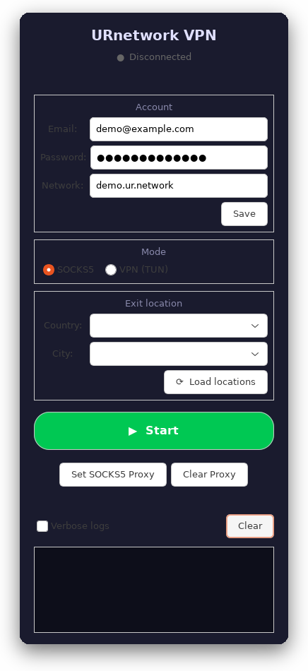

# URnetwork VPN client for Ubuntu

[](https://github.com/Blqd/urnetwork-client/actions/workflows/ci.yml)

**English** | [Русский](README.md)



**A peer-to-peer VPN for Ubuntu with a native GTK3 GUI.** Enter your URnetwork
credentials, press Start. The password lives in GNOME Keyring, SOCKS5 mode runs
without root, TUN takes over the default route and blocks the IPv6 leak.

- **One `.deb`** — no Snap, Flatpak or AppImage: `urnetwork-gui`,
  `urnetwork-connect status|socks|vpn|off` and the desktop entry come together.
- **No Electron shell**: a Python + GTK3 GUI on top of a Go networking stack
  built from source (`lib/connect`, `lib/sdk`, `lib/proxy`).
- **Explicit privileges**: root is needed only for TUN, and the package installs
  no sudoers rules (opt-in: `scripts/install-nopasswd.sh`).

A peer-to-peer VPN client built on URnetwork: a Go networking stack
(`lib/connect`, `lib/sdk`, `lib/proxy`), CLI tools/daemons and a GTK3 GUI in
Python.

The client supports two modes:

| Mode | What runs | How traffic reaches the tunnel |
|---|---|---|
| SOCKS5 (no root) | `build/socksproxy` | Apps/system use `127.0.0.1:9999` |
| TUN (root required) | `build/urnetwork-vpn` | The default route is moved into the `urnetwork` device |

## Install from a release (Ubuntu 22.04+)

```bash
gh release download -R Blqd/urnetwork-client --pattern '*.deb'
sudo dpkg -i urnetwork-client_*.deb
sudo apt-get -f install   # install dependencies if dpkg asks for them
urnetwork-gui
```

No `gh`? Grab the `.deb` from the [releases page](https://github.com/Blqd/urnetwork-client/releases/latest)
and install it with the same `dpkg -i`.

## Building from source

```bash
git clone https://github.com/Blqd/urnetwork-client.git
cd urnetwork-client

# 1. Build (Go >= 1.26 is required: make pins GOTOOLCHAIN=go1.26.0)
make build

# 2. Register the account (once)
scripts/urnetwork-connect.sh register you@example.com 'password'

# 3. Run
./scripts/urnetwork-gui-launch.sh          # GUI
sudo scripts/urnetwork-connect.sh vpn      # VPN in a terminal
scripts/urnetwork-connect.sh socks         # SOCKS5 in a terminal
scripts/urnetwork-connect.sh status        # what is running now
sudo scripts/urnetwork-connect.sh off      # stop everything and restore routes
```

GUI: run `scripts/install-desktop-entry.sh` (adds a menu entry), then launch
“URnetwork VPN”.

## Prebuilt releases

Ready `.deb` packages and standalone `linux-amd64` binaries are attached to
[GitHub Releases](https://github.com/Blqd/urnetwork-client/releases), with a
`SHA256SUMS` file. To build them yourself:

```bash
make build          # binaries are required for packaging
make deb            # -> dist/urnetwork-client_<version>_<arch>.deb
```

## Installing the .deb

```bash
sudo dpkg -i dist/urnetwork-client_*.deb
sudo apt-get -f install   # install dependencies if dpkg asks for them
```

The package installs everything under `/usr/lib/urnetwork` and adds to `$PATH`:

| Command | Purpose |
|---|---|
| `urnetwork-gui` | GTK3 GUI (menu entry “URnetwork VPN”) |
| `urnetwork-connect status\|socks\|vpn\|off` | terminal control |
| `urnetwork-vpn` | the TUN engine itself (normally started via `urnetwork-connect`) |

Package requirements: `python3`, `python3-gi`, `gir1.2-gtk-3.0`,
`gir1.2-secret-1`, `sudo`, `iproute2`, `curl`, `libc6 (>= 2.34)`
(Ubuntu 22.04+). The package **does not** add sudoers rules: a separate
terminal window asks for the sudo password when the VPN mode starts (once per
run). If you do not want to type it every time, install the rule from
`scripts/install-nopasswd.sh` — see “Security”.

Removal: `sudo dpkg -r urnetwork-client` (configuration in
`~/.config/urnetwork` is kept).

## Configuration

`~/.config/urnetwork/` (mode 0700):

| File | Purpose |
|---|---|
| `auth` | `USER_AUTH` / `NETWORK_NAME`; the password lives in the keyring (fallback: `PASSWORD`, `0600`) |
| `diagnostic.log` | GUI log, rotated to `diagnostic.log.1` at 10 MB |
| `launcher.log` | desktop-entry wrapper log |
| `state.json` | tunnel state (written by `urnetwork-vpn`) |
| `connect.lock` | prevents two concurrent starts |
| `default-route.before` | default route before connecting (used for restore) |

Credentials can also be passed via the environment instead of the file:
`USER_AUTH=... PASSWORD=... build/socksproxy`.

## Security

- The password never appears in `argv` of the GUI or the engines: it is passed
  via the environment or the helper's stdin (`ps` does not show it). The one
  exception is `register`: it hands the password to the upstream provider binary
  on its command line, so the password is briefly visible in `ps` during
  registration.
- The URnetwork password is **stored in the system secret store** (GNOME
  Keyring / Secret Service) by default, through
  `scripts/urnetwork-credentials.py`. `~/.config/urnetwork/auth` keeps only
  `USER_AUTH`/`NETWORK_NAME`; a legacy plaintext password is migrated to the
  keyring on first run. Without a secret service (SSH, bare WM) the GUI falls
  back to a `0600` file. Force the file mode with `URNETWORK_KEYRING=0`.
- `scripts/install-nopasswd.sh` **no longer grants NOPASSWD on files inside the
  git checkout**. It copies the launcher and binaries to
  `/usr/local/libexec/` (root-owned) and authorises sudo only for that copy.
  The old variant (`NOPASSWD` on a user-writable script plus `/usr/sbin/ip`)
  was equivalent to passwordless root. Re-run the installer after `make build`
  or after editing the launcher.
- SOCKS5 listens on `127.0.0.1:9999` by default. If it is exposed to the
  network, the client warns: the SOCKS server has no authentication.
- TLS: minimum version 1.3 for API and control connections.

### sudo password in a separate terminal window

The GUI has no terminal, so `sudo` cannot ask for a password by itself. When a
password is really needed, the GUI passes
`SUDO_ASKPASS=scripts/urnetwork-askpass.sh`; the helper opens its own terminal
window, and the typed password goes straight to `sudo` (not through `argv`
and not through a file on disk). If the rule from
`scripts/install-nopasswd.sh` is installed, no window appears at all — `sudo`
asks nothing. Details are in [`docs/analysis.md`](docs/analysis.md), §8.8.

## What changed in this iteration

The full analysis with numbers is in [`docs/analysis.md`](docs/analysis.md).

- **VPN core** (`cmd/urnetwork-vpn/main.go`): previously every packet was
  printed to stdout (`[TUN>>]`/`[<<TUN]`) and sent synchronously with a 15 s
  timeout — when the pipe filled up or the provider was slow, forwarding
  stalled. Now packets are not logged unless `--verbose`; sending goes through
  a bounded queue (`--send-queue`, default 2048) and workers
  (`--send-workers`); the read buffer is reused; a statistics line is printed
  every 10 s (`stats: tx ... rx ... dropped=... queue=...`) and the state is
  written to `state.json`.
- **Routing**: the default route is saved to `default-route.before`;
  `off`/`trap` restore it, and if the process crashes the GUI calls `off`
  itself. An IPv6 “black hole” route was added (`--block-ipv6`, on by default)
  so IPv6 cannot leak outside the tunnel; the MTU comes from `--mtu`
  (previously it was hard-coded to 1400).
- **TUN device**: `createTun` no longer deletes somebody else's `urnetwork`
  device before opening; instead it reports a clear error and supports
  `--replace-tun`. Deleting the other device was exactly what produced
  `tun read error: bad address` and `Cannot find device "urnetwork"` in the
  logs.
- **SOCKS proxy** (`lib/proxy/socks/main.go`): listens on loopback, bind errors
  are no longer ignored, empty packets and read errors are not sent into the
  tunnel, `Dialing` logs only with `--verbose`.
- **Proxy stack** (`lib/proxy/tun.go`): channel buffer 512 packets (was 32),
  `WriteTimeout` 1 s, the dial address is rotated between attempts instead of
  picked randomly.
- **Library** (`lib/connect`): fixed a crash on an empty packet from a peer
  (`ParseIpPathWithPayload`), the JWT parser no longer panics on non-string
  claims, `NetworkId` is read from `network_id` (it was copy-pasted from
  `network_name`), TLS 1.3.
- **GUI** (`gui/urnetwork-gui.py`): the URnetwork password is kept in the
  system secret store (GNOME Keyring); `auth` holds only
  account/network and is written atomically with `0600`; reading stdout no
  longer blocks the GTK loop (non-blocking fd plus a line buffer); log lines
  are filtered in the UI (glog lines are hidden unless verbose) and only
  displayed lines are written to disk — `diagnostic.log` used to grow to
  1.6 GB; SIGTERM → SIGKILL after 5 s; `off` is called on any engine exit;
  a single GUI instance (flock); system-proxy buttons are active only in
  SOCKS mode.
- **Scripts** (`scripts/urnetwork-connect.sh`): `auth` is parsed instead of
  `source`d; credentials reach the engines only via env and the root copy via a
  `0600` file (see below); `flock` prevents double starts; the
  engine is restarted after a crash (previously `wait $pid` under `set -e`
  killed the script before any retry); the route is restored and a stale TUN
  is removed; `register` downloads the binary via `mktemp` and unpacks it
  without the old `tar A || tar B && cp` bug.
- **Tests/build**: `make test` (Go client tests + pytest, 44 tests + `bash -n`
  + `py_compile`), `make build` (PIE, `-s -w`), `make install`, `make deb`
  (`dist/urnetwork-client_*.deb`), CI workflow, release workflow for tags.

### After the review (commit `0429d4a`)

Full details in [`docs/analysis.md`](docs/analysis.md), §8.11.

- **Privileges**: the sudoers `env_keep` no longer carries `USER_AUTH`,
  `PASSWORD`, `URNETWORK_CONFIG_DIR` or `URNETWORK_STATE_FILE` — only
  `URNETWORK_VERBOSE`. Credentials reach the root launcher in a `0600` file that
  is ownership-checked and deleted after reading; `register` refuses to run as
  root; the root engine only accepts a state file inside the user's config
  directory.
- **Process liveness**: `status`/`off` check `/proc/<pid>` and
  `/proc/<pid>/exe` instead of `kill -0` (which reports `EPERM` for the
  root-owned engine); the broad `pkill -f` is replaced with the targeted
  `kill_engines_by_exe`.
- **Shutdown**: `sender.Stop()` no longer drains the queue (it could wait up to
  2048 × 15 s) — workers exit on a signal and the remainder is counted in
  `txDropped`.
- **GUI**: a trailing stdout line without `\n` is flushed on `IO_HUP`/EOF (the
  last lines before an engine crash are no longer lost); the `TextView` is
  capped at `LOG_BUFFER_MAX_CHARS = 400 000`.
- **Misc**: `restore_default_route` validates the route journal,
  `list-locations` propagates the engine exit code, `--city` is not appended to
  the flag slice any more.
- **Tests**: `tests/test_connect_script_static.py` (static audit of the
  scripts), Go tests `TestResolveStateFilePathIn` and
  `TestPacketSenderStopDropsQueued`, GUI tests for the stdout tail flush and the
  buffer cap — 44 pytest tests in total.

## Known limitations

- No IPv6 inside the tunnel: IPv6 traffic is either blocked or goes around the
  tunnel (see `--block-ipv6`).
- SOCKS5 has no authentication — do not expose it to the network.
- `lib/connect` contains historical issues described in
  [`docs/code-review.md`](docs/code-review.md) and
  [`docs/refactoring-plan.md`](docs/refactoring-plan.md); they are outside this
  iteration (5 of 12 tickets closed, 1 partial).
- `register` is the only place where the password ends up in `argv` (that is how
  the upstream registrar works).
- The GUI reads the keyring on the GTK main thread: if the secret service hangs,
  GUI start can be delayed by up to 20 s (timeout).
- The GUI ignores `URNETWORK_CONFIG_DIR` (it uses `~/.config/urnetwork`) — a
  divergence from the CLI script.
- In VPN mode the root copy always uses the invoking user's directory from
  `SUDO_USER` (`~/.config/urnetwork`): a custom `URNETWORK_CONFIG_DIR` is not
  honoured in root mode (it works in SOCKS mode). This is deliberate — otherwise
  a user-supplied directory would become root input.

## Documentation

| File | Contents |
|---|---|
| [`docs/analysis.md`](docs/analysis.md) | how the client works, the issues found, what is implemented and what is left |
| [`docs/code-review.md`](docs/code-review.md) | review of the vendored libraries (JWT, panics, TLS, egress policy) |
| [`docs/refactoring-plan.md`](docs/refactoring-plan.md) | refactoring plan for the upstream libraries |
| [`SECURITY.md`](SECURITY.md) | threat model: root, sudo, passwords, SOCKS5 |
| [`CONTRIBUTING.md`](CONTRIBUTING.md) | build, tests, project layout |
| [`THIRD_PARTY.md`](THIRD_PARTY.md) | vendored libraries, licenses, local patches |
| [`CODE_OF_CONDUCT.md`](CODE_OF_CONDUCT.md) | rules for issues/PR discussions (RU + EN) |

## Checking after changes

```bash
make test            # go test + pytest (44) + bash -n + py_compile
make build           # build/urnetwork-vpn, build/socksproxy (PIE, -s -w)
make deb             # dist/urnetwork-client_*.deb (lintian must be clean)
sudo -n /usr/local/libexec/urnetwork/urnetwork-connect.sh status   # if NOPASSWD was installed
```

Live SOCKS5 check (the egress IP must differ from the direct one; the password
comes from the system secret store, so `auth` no longer contains
`PASSWORD=`):

```bash
export USER_AUTH=you@example.com
export PASSWORD="$(scripts/urnetwork-credentials.py get "$USER_AUTH")"
build/socksproxy & sleep 4
curl -s --socks5-hostname 127.0.0.1:9999 https://api.ipify.org; echo
kill %1
```

Live TUN check (root required; without the sudoers rule a terminal window with
askpass opens):

```bash
bash scripts/urnetwork-connect.sh vpn      # in another terminal
ip route show default                      # default dev urnetwork … metric 10
ip -6 route show | grep blackhole          # blackhole default … (IPv6 closed)
bash scripts/urnetwork-connect.sh off      # the route is restored from the backup
```

## License

The project is distributed under the [Mozilla Public License 2.0](LICENSE).
Vendored libraries keep their own `LICENSE` files; their origin and local
changes are listed in [`THIRD_PARTY.md`](THIRD_PARTY.md).
