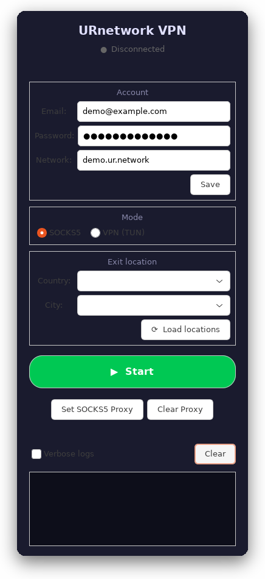

# URnetwork VPN client для Ubuntu

[](https://github.com/Blqd/urnetwork-client/actions/workflows/ci.yml)

**[Русский](README.md) | [English](README.en.md)**



**P2P-VPN для Ubuntu с родным GTK3-интерфейсом.** Ввёл аккаунт URnetwork —
нажал Start. Пароль лежит в GNOME Keyring, режим SOCKS5 работает без root,
TUN забирает системный маршрут и закрывает утечку IPv6.

- **Один `.deb`** — без Snap, Flatpak и AppImage: `urnetwork-gui`,
  `urnetwork-connect status|socks|vpn|off` и пункт меню ставятся вместе.
- **Без Electron-обёрток**: GUI на Python + GTK3, сетевой стек — Go,
  собранный из исходников (`lib/connect`, `lib/sdk`, `lib/proxy`).
- **Прозрачные привилегии**: root нужен только для TUN, правила sudoers
  пакет не добавляет (опционально — `scripts/install-nopasswd.sh`).

Клиент P2P-VPN на базе URnetwork: Go-стек (`lib/connect`, `lib/sdk`, `lib/proxy`),
CLI/демоны и GTK3-GUI на Python.

> **English.** A peer-to-peer VPN client for Ubuntu: a Go networking stack
> (vendored `urnetwork` libraries, see [`THIRD_PARTY.md`](THIRD_PARTY.md)) plus a
> GTK3/PyGObject GUI. SOCKS5 mode needs no root; TUN mode routes the default
> route into the `urnetwork` device. Build with `make build`, test with
> `make test`; details and the audit results are in [`docs/`](docs/analysis.md).

Клиент умеет работать в двух режимах:

| Режим | Что запускается | Как трафик попадает в туннель |
|---|---|---|
| SOCKS5 (без root) | `build/socksproxy` | Приложение/система идёт через `127.0.0.1:9999` |
| TUN (нужен root) | `build/urnetwork-vpn` | Default route уводится в устройство `urnetwork` |

## Установка из релиза (Ubuntu 22.04+)

```bash
gh release download -R Blqd/urnetwork-client --pattern '*.deb'
sudo dpkg -i urnetwork-client_*.deb
sudo apt-get -f install   # доустановить зависимости, если dpkg попросит
urnetwork-gui
```

Без `gh` — скачайте `.deb` со [страницы релизов](https://github.com/Blqd/urnetwork-client/releases/latest)
и поставьте тем же `dpkg -i`.

## Сборка из исходников

```bash
git clone https://github.com/Blqd/urnetwork-client.git
cd urnetwork-client

# 1. Сборка (нужен Go >= 1.26: make ставит GOTOOLCHAIN=go1.26.0)
make build

# 2. Регистрация аккаунта (один раз)
scripts/urnetwork-connect.sh register you@example.com 'пароль'

# 3. Запуск
./scripts/urnetwork-gui-launch.sh          # GUI
sudo scripts/urnetwork-connect.sh vpn      # VPN в терминале
scripts/urnetwork-connect.sh socks         # SOCKS5 в терминале
scripts/urnetwork-connect.sh status        # что сейчас запущено
sudo scripts/urnetwork-connect.sh off      # остановить всё и вернуть маршруты
```

GUI: `scripts/install-desktop-entry.sh` (пункт меню), затем запуск «URnetwork VPN».

## Готовые сборки

Готовые `.deb` и отдельные бинарники `linux-amd64` (`urnetwork-vpn`,
`socksproxy`) лежат в
[GitHub Releases](https://github.com/Blqd/urnetwork-client/releases) вместе с
файлом `SHA256SUMS`. Каждый релиз собирается CI по тегу `v*`
([`.github/workflows/release.yml`](.github/workflows/release.yml)).

Собрать пакет самостоятельно:

```bash
make build          # бинарники нужны для упаковки
make deb            # -> dist/urnetwork-client_<версия>_<arch>.deb
```

## Установка из .deb

```bash
sudo dpkg -i dist/urnetwork-client_*.deb
sudo apt-get -f install   # доустановить зависимости, если dpkg попросит
```

Пакет ставит всё в `/usr/lib/urnetwork` и добавляет в `$PATH`:

| Команда | Что делает |
|---|---|
| `urnetwork-gui` | GTK3 GUI (пункт меню «URnetwork VPN») |
| `urnetwork-connect status\|socks\|vpn\|off` | управление из терминала |
| `urnetwork-vpn` | сам TUN-движок (обычно запускается через `urnetwork-connect`) |

Требования пакета: `python3`, `python3-gi`, `gir1.2-gtk-3.0`, `gir1.2-secret-1`,
`sudo`, `iproute2`, `curl`, `libc6 (>= 2.34)` (Ubuntu 22.04+). Пакет **не**
добавляет правил sudoers: окно с паролем sudo появляется при старте VPN-режима
(один раз на запуск). Кто не хочет вводить пароль каждый раз, может поставить
правило из `scripts/install-nopasswd.sh` — см. раздел «Безопасность».

Удаление: `sudo dpkg -r urnetwork-client` (конфигурация в `~/.config/urnetwork`
остаётся).

## Конфигурация

`~/.config/urnetwork/` (права 0700):

| Файл | Назначение |
|---|---|
| `auth` | `USER_AUTH` / `NETWORK_NAME`; пароль — в keyring (fallback: `PASSWORD`, `0600`) |
| `diagnostic.log` | лог GUI, ротация на 10 МБ в `diagnostic.log.1` |
| `launcher.log` | лог обёртки desktop-entry |
| `state.json` | состояние туннеля (пишет `urnetwork-vpn`) |
| `connect.lock` | защита от двух одновременных запусков |
| `default-route.before` | маршрут по умолчанию до подключения (для восстановления) |

Креды можно не писать в файл, а передавать через окружение:
`USER_AUTH=... PASSWORD=... build/socksproxy`.

## Безопасность

- Пароль не попадает в `argv` GUI и движков: он передаётся только через
  окружение или stdin helper'а (`ps` его не показывает). Исключение — шаг
  `register`: он передаёт пароль сторонней библиотеке upstream в `argv`, поэтому
  в момент регистрации пароль виден в `ps`.
- Пароль URnetwork **по умолчанию хранится в системном хранилище секретов**
  (GNOME Keyring / Secret Service) через `scripts/urnetwork-credentials.py`.
  В `~/.config/urnetwork/auth` остаются только `USER_AUTH`/`NETWORK_NAME`;
  старый пароль из файла при первом запуске автоматически переносится в
  keyring. Если секретного сервиса нет (SSH, голый WM), GUI падает обратно на
  файл с правами `0600`. Отключить keyring принудительно:
  `URNETWORK_KEYRING=0`.
- `scripts/install-nopasswd.sh` **больше не выдаёт NOPASSWD на файлы в git-чекауте**.
  Он копирует launcher и бинарники в `/usr/local/libexec/` (владелец root) и
  разрешает sudo только на эту копию. Старый вариант (`NOPASSWD` на
  user-writable скрипт + `/usr/sbin/ip`) был эквивалентен passwordless root.
  После `make build` или правки launcher'а установщик нужно запустить заново.
- Правило sudoers **не сохраняет переменные окружения с учётными данными**:
  `env_keep` ограничен `URNETWORK_VERBOSE`. Аккаунт передаётся root-копии
  launcher'а через файл `~/.config/urnetwork/.creds.<pid>` с правами `0600`,
  который удаляется сразу после чтения, а не через `USER_AUTH`/`PASSWORD` в
  окружении sudo. Движок под root **игнорирует** `URNETWORK_STATE_FILE` вне
  каталога конфигурации пользователя (определяется по `SUDO_UID`) и выводит
  предупреждение — иначе через эту переменную можно было записать или удалить
  произвольный файл от root. `register` отказывается работать под root.
- Перед сигналом процессам из pid-файлов проверяется
  `/proc/<pid>/exe` (socksproxy/urnetwork-vpn), поэтому запущенный от root
  движок корректно виден и из пользовательской сессии, а чужие процессы не
  убиваются. Журнал маршрута (`ROUTE_BACKUP`) валидируется перед восстановлением.
- SOCKS5 по умолчанию слушает только `127.0.0.1:9999`. Если открыть его наружу,
  клиент предупредит: аутентификации в SOCKS-сервере нет.
- TLS: минимальная версия 1.3 для API и control-соединений.

### Пароль sudo в отдельном окне терминала

У GUI нет терминала, поэтому `sudo` не может спросить пароль сам. Когда пароль
действительно нужен, GUI передаёт `SUDO_ASKPASS=scripts/urnetwork-askpass.sh`,
и помощник открывает отдельное окно терминала; набранный пароль уходит прямо в
`sudo` (не через `argv` и не через файл на диске). Если установлено правило из
`scripts/install-nopasswd.sh`, окно не появляется вообще — `sudo` ничего не
спрашивает. Подробности — в
[`docs/analysis.md`](docs/analysis.md), п. 8.8.

## Что изменилось в этой итерации

Полный разбор с числами — в [`docs/analysis.md`](docs/analysis.md).

- **VPN-ядро** (`cmd/urnetwork-vpn/main.go`): раньше каждый пакет печатался в
  stdout (`[TUN>>]`/`[<<TUN]`) и отправлялся синхронно с таймаутом 15 c — при
  заполнении pipe или медленном провайдере forwarding вставал. Теперь: пакеты
  не логируются без `--verbose`, отправка идёт через ограниченную очередь
  (`--send-queue`, по умолчанию 2048) и воркеров (`--send-workers`), буфер
  чтения переиспользуется, раз в 10 c печатается строка статистики
  (`stats: tx ... rx ... dropped=... queue=...`), состояние пишется в
  `state.json`.
- **Маршрутизация**: дефолтный маршрут сохраняется в `default-route.before`,
  `off`/`trap` его восстанавливают; при падении процесса GUI сам вызывает
  `off`. Добавлена «чёрная дыра» для IPv6 (`--block-ipv6`, включена по
  умолчанию), чтобы IPv6 не утекал мимо туннеля; MTU берётся из `--mtu` (раньше
  был жёстко зашит 1400).
- **TUN-устройство**: `createTun` больше не удаляет чужой `urnetwork` перед
  открытием; вместо этого — понятная ошибка и флаг `--replace-tun`. Именно
  удаление чужого устройства давало в логах `tun read error: bad address` и
  `Cannot find device "urnetwork"`.
- **SOCKS-прокси** (`lib/proxy/socks/main.go`): слушает loopback, ошибка bind
  больше не игнорируется, пустые пакеты и ошибки чтения не отправляются в
  туннель, логи `Dialing` — только с `--verbose`.
- **Прокси-стек** (`lib/proxy/tun.go`): буфер канала 512 пакетов (было 32),
  `WriteTimeout` 1 c, адрес выбирается по кругу между попытками dial, а не
  случайно.
- **Библиотека** (`lib/connect`): устранён crash на пустом пакете от пира
  (`ParseIpPathWithPayload`), JWT больше не паникует на не-строковых claim'ах,
  `NetworkId` читается из `network_id` (был copy-paste из `network_name`),
  TLS 1.3.
- **GUI** (`gui/urnetwork-gui.py`): пароль URnetwork хранится в системном
  хранилище секретов (GNOME Keyring), в `auth` — только аккаунт/сеть;
  `auth` пишется атомарно с правами `0600`;
  чтение stdout не блокирует GTK-цикл (неблокирующий fd + построчный буфер);
  логи банятся в UI (glog-строки скрыты, пока не включён verbose) и на диск
  пишутся только отображаемые строки — раньше `diagnostic.log` вырос до 1.6 ГБ;
  SIGTERM → SIGKILL через 5 c; при любом завершении движка вызывается `off`;
  один экземпляр GUI (flock); кнопки системного прокси активны только в
  SOCKS-режиме.
- **Скрипты** (`scripts/urnetwork-connect.sh`): `auth` парсится, а не
  `source`-ится; kredы для движков — только через env, а root-копии — файлом
  `0600` (после ревью, см. ниже); `flock` от двойного запуска; рестарт
  при падении (раньше `wait $pid` под `set -e` убивал скрипт до retry);
  восстановление маршрута и удаление stale TUN; `register` качает бинарник через
  `mktemp` и раскладывает без старого бага `tar A || tar B && cp`.
- **Тесты/сборка**: `make test` (Go-тесты клиента + pytest, 44 теста + `bash -n`
  + `py_compile`), `make build` (PIE, `-s -w`), `make install`, `make deb`
  (пакет `dist/urnetwork-client_*.deb`), CI-workflow.

### После ревью (коммит `0429d4a`)

Подробно — [`docs/analysis.md`](docs/analysis.md), п. 8.11.

- **Привилегии**: из sudoers `env_keep` убраны `USER_AUTH`, `PASSWORD`,
  `URNETWORK_CONFIG_DIR`, `URNETWORK_STATE_FILE` — остался только
  `URNETWORK_VERBOSE`. Креды идут root-копии файлом `0600`, который проверяется
  по владельцу и удаляется; `register` под root запрещён; state-файл от root
  ограничен каталогом пользователя.
- **Живость процессов**: `status`/`off` проверяют `/proc/<pid>` и
  `/proc/<pid>/exe` вместо `kill -0` (который даёт `EPERM` для root-движка);
  широкий `pkill -f` заменён на адресный `kill_engines_by_exe`.
- **Остановка**: `sender.Stop()` больше не досылает очередь (раньше мог ждать
  до 2048 × 15 c) — воркеры завершаются по сигналу, остаток учитывается в
  `txDropped`.
- **GUI**: хвост stdout без `\n` сбрасывается при `IO_HUP`/EOF (последние строки
  перед падением движка не теряются), `TextView` ограничен
  `LOG_BUFFER_MAX_CHARS = 400 000`.
- **Прочее**: `restore_default_route` валидирует журнал маршрута,
  `list-locations` возвращает код движка, `--city` не подменяется `append`'ом к
  слайсу флага.
- **Тесты**: `tests/test_connect_script_static.py` (статический аудит скриптов),
  Go-тесты `TestResolveStateFilePathIn` и `TestPacketSenderStopDropsQueued`,
  GUI-тесты на сброс хвоста и лимит буфера — всего 44 pytest.

## Известные ограничения

- Нет IPv6 внутри туннеля: IPv6-трафик либо блокируется, либо идёт мимо
  (см. `--block-ipv6`).
- SOCKS5 без аутентификации — не открывайте наружу.
- `lib/connect` содержит исторические проблемы, разобранные в
  [`docs/code-review.md`](docs/code-review.md) и
  [`docs/refactoring-plan.md`](docs/refactoring-plan.md); они не входят в
  текущую итерацию (закрыто 5 задач из 12, 1 частично).
- `register` — единственное место, где пароль оказывается в `argv` (так устроен
  upstream-регистратор).
- GUI читает keyring на главном потоке GTK: если сервис секретов завис, старт
  GUI может задержаться до 20 c (таймаут).
- GUI не учитывает `URNETWORK_CONFIG_DIR` (использует `~/.config/urnetwork`) —
  расхождение с CLI-скриптом.
- В VPN-режиме root-копия всегда использует каталог пользователя из `SUDO_USER`
  (`~/.config/urnetwork`): нестандартный `URNETWORK_CONFIG_DIR` в root-режиме не
  подхватывается (в SOCKS-режиме работает). Выбор сделан осознанно — иначе
  каталог конфигурации от пользователя стал бы входом для root.

## Документация

| Файл | Содержание |
|---|---|
| [`docs/analysis.md`](docs/analysis.md) | разбор работы клиента, найденные проблемы, что уже внедрено и что осталось |
| [`docs/code-review.md`](docs/code-review.md) | ревью вендоренных библиотек (JWT, паники, TLS, egress-политика) |
| [`docs/refactoring-plan.md`](docs/refactoring-plan.md) | план рефакторинга upstream-библиотек |
| [`SECURITY.md`](SECURITY.md) | модель угроз: root, sudo, пароли, SOCKS5 |
| [`CONTRIBUTING.md`](CONTRIBUTING.md) | сборка, тесты, структура проекта |
| [`THIRD_PARTY.md`](THIRD_PARTY.md) | вендоренные библиотеки, лицензии, локальные патчи |
| [`CODE_OF_CONDUCT.md`](CODE_OF_CONDUCT.md) | правила общения в issues/PR (RU + EN) |

## Проверка после изменений

```bash
make test            # go test + pytest (44) + bash -n + py_compile
make build           # build/urnetwork-vpn, build/socksproxy (PIE, -s -w)
make deb             # dist/urnetwork-client_*.deb (lintian должен быть чист)
sudo -n /usr/local/libexec/urnetwork/urnetwork-connect.sh status   # если ставили NOPASSWD
```

Live-проверка SOCKS5 (egress-IP должен отличаться от прямого; пароль берётся
из системного хранилища, поэтому `auth` больше не содержит `PASSWORD=`):

```bash
export USER_AUTH=you@example.com
export PASSWORD="$(scripts/urnetwork-credentials.py get "$USER_AUTH")"
build/socksproxy & sleep 4
curl -s --socks5-hostname 127.0.0.1:9999 https://api.ipify.org; echo
kill %1
```

Live-проверка TUN (нужен root; при отсутствии правила sudo откроется окно
терминала с askpass):

```bash
bash scripts/urnetwork-connect.sh vpn      # в другом терминале
ip route show default                      # default dev urnetwork … metric 10
ip -6 route show | grep blackhole          # blackhole default … (IPv6 закрыт)
bash scripts/urnetwork-connect.sh off      # маршрут восстанавливается из backup
```

## Лицензия

Проект распространяется под [Mozilla Public License 2.0](LICENSE).
Вендоренные библиотеки сохраняют собственные файлы `LICENSE`; их происхождение
и локальные изменения перечислены в [`THIRD_PARTY.md`](THIRD_PARTY.md).
